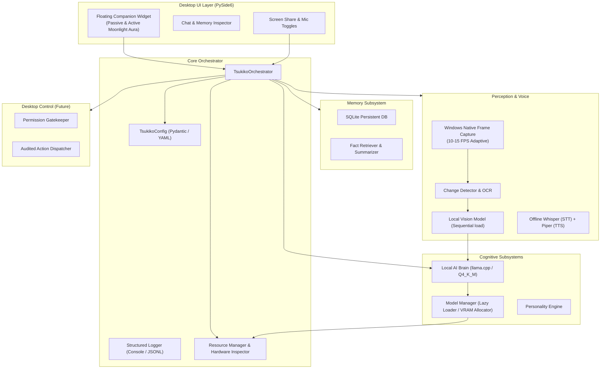

# Tsukiko System Architecture

## 1. Architectural Philosophy

Tsukiko is structured around four non-negotiable principles:
1. **Decoupled Autonomy**: Each subsystem (Brain, Memory, Perception, Voice, UI, Desktop Control) can function, be tested, and be initialized independently.
2. **Resource Conservatism**: On an RTX 3050 4GB GPU and 16GB system RAM, models are never left idle in VRAM without cause. VRAM budgets are strictly measured before loading.
3. **Explicit Consent & Privacy**: Capture, microphone listening, and desktop interaction are physically blocked by default until explicitly enabled by the user in the UI.
4. **Deterministic Fail-Safes**: If GPU acceleration or ML libraries are unavailable, systems degrade gracefully to optimized CPU fallbacks or report transparent diagnostics.

---

## 2. Subsystem Decomposition

---

## 3. Subsystem Breakdown

### 3.1 Core Orchestrator (`app/core/orchestrator/`)
* Acts as the composition root.
* Coordinates lifecycle (`initialize()`, `start()`, `stop()`).
* Tracks subsystem status across sessions.
* Enforces invariant security policies (e.g., verifying `local_only=True` at startup).

### 3.2 Resource Manager (`app/core/resource_manager/`)
* Queries `nvidia-smi` and `psutil` in real-time.
* Calculates safe VRAM bounds:
  $$\text{Safe VRAM} = \text{Total VRAM} - 1200\text{ MB (OS Headroom)}$$
* Evaluates framework readiness (detects whether CUDA is actually operational before launching GPU workloads).

### 3.3 Local Brain & Model Manager (`app/core/brain/`, `app/core/model_manager/`)
* Target: 3B–4B parameter quantized models (Q4_K_M).
* Employs lazy loading on first query.
* Auto-unloads models after prolonged inactivity to free VRAM for system responsiveness or vision processing.

### 3.4 Persistent Long-Term Memory (`app/memory/`)
* SQLite-backed relational schema storing:
  * Conversational turns.
  * Extracted facts (user preferences, project details, user instructions).
  * Summarized session memory.
* Transparent inspection: Users can browse, update, or purge any stored fact.

### 3.5 Live Desktop Perception (`app/perception/`)
* **Strict Privacy Gate**: Capturer thread does not run while switch is OFF.
* **Adaptive Pipeline**:
  1. Capture frames at 10–15 FPS.
  2. Perform fast pixel change detection.
  3. If significant UI delta occurs, run OCR / UI Automation.
  4. Only invoke heavy visual reasoning models when user explicitly asks about the screen or when critical tasks require understanding.
* Never records continuous raw desktop video unless explicitly enabled.

### 3.6 Desktop Control & Security (`app/desktop/permissions/`)
* Strict permission architecture for future action execution.
* Model proposals must pass through explicit user confirmation dialogs before execution.
* Audit trail logged to `logs/tsukiko.jsonl`.
