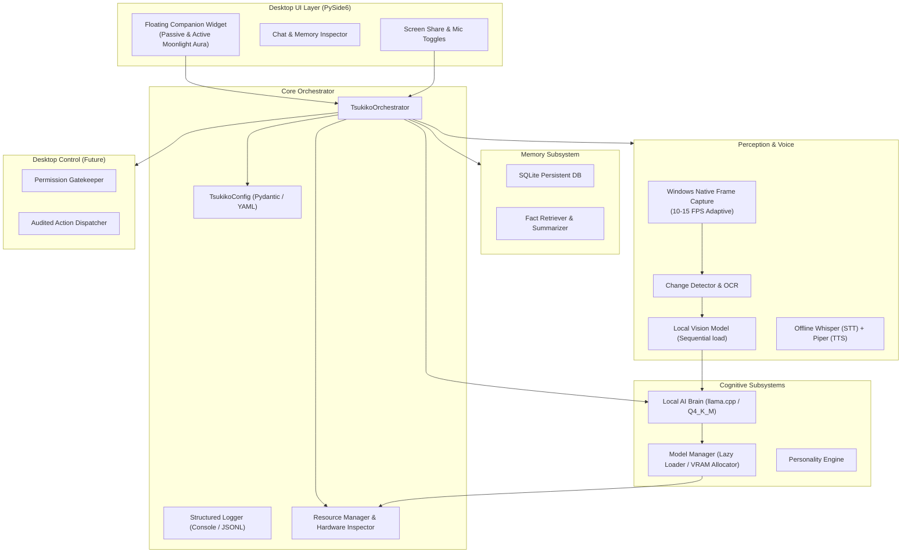

# Tsukiko System Architecture

## 1. Architectural Philosophy

Tsukiko is structured around four non-negotiable principles:
1. **Decoupled Autonomy**: Each subsystem (Brain, Memory, Perception, Voice, UI, Desktop Control) can function, be tested, and be initialized independently.
2. **Resource Conservatism**: On an RTX 3050 4GB GPU and 16GB system RAM, models are never left idle in VRAM without cause. VRAM budgets are strictly measured before loading.
3. **Explicit Consent & Privacy**: Capture, microphone listening, and desktop interaction are physically blocked by default until explicitly enabled by the user in the UI.
4. **Deterministic Fail-Safes**: If GPU acceleration or ML libraries are unavailable, systems degrade gracefully to optimized CPU fallbacks or report transparent diagnostics.

---

## 2. Subsystem Decomposition

---

## 3. Subsystem Breakdown

### 3.1 Core Orchestrator (`app/core/orchestrator/`)
* Acts as the composition root.
* Coordinates lifecycle (`initialize()`, `start()`, `stop()`).
* Tracks subsystem status across sessions.
* Enforces invariant security policies (e.g., verifying `local_only=True` at startup).

### 3.2 Resource Manager (`app/core/resource_manager/`)
* Queries `nvidia-smi` and `psutil` in real-time.
* Calculates safe VRAM bounds:
  $$\text{Safe VRAM} = \text{Total VRAM} - 1200\text{ MB (OS Headroom)}$$
* Evaluates framework readiness (detects whether CUDA is actually operational before launching GPU workloads).

### 3.3 Local Brain & Model Manager (`app/core/brain/`, `app/core/model_manager/`)
* Target: 3B–4B parameter quantized models (Q4_K_M).
* Employs lazy loading on first query.
* Auto-unloads models after prolonged inactivity to free VRAM for system responsiveness or vision processing.

### 3.4 Persistent Long-Term Memory (`app/memory/`)
* SQLite-backed relational schema storing:
  * Conversational turns.
  * Extracted facts (user preferences, project details, user instructions).
  * Summarized session memory.
* Transparent inspection: Users can browse, update, or purge any stored fact.

### 3.5 Live Desktop Perception (`app/perception/`)
* **Strict Privacy Gate**: Capturer thread does not run while switch is OFF.
* **Adaptive Pipeline**:
  1. Capture frames at 10–15 FPS.
  2. Perform fast pixel change detection.
  3. If significant UI delta occurs, run OCR / UI Automation.
  4. Only invoke heavy visual reasoning models when user explicitly asks about the screen or when critical tasks require understanding.
* Never records continuous raw desktop video unless explicitly enabled.

### 3.6 Desktop Control & Security (`app/desktop/permissions/`)
* Strict permission architecture for future action execution.
* Model proposals must pass through explicit user confirmation dialogs before execution.
* Audit trail logged to `logs/tsukiko.jsonl`.

### 3.7 Desktop Companion UI Subsystem (`app/desktop/companion/`)
* **Floating Companion Widget (`FloatingCompanionWidget`)**:
  * Frameless, transparent floating Qt window displaying Tsukiko logo/avatar emblem.
  * Procedural vector rendering (`QPainter`) without VRM, Live2D, 3D character, or GPU engine.
  * Draggable across display work area with screen boundary clamping.
  * Left-clicking the logo toggles the compact vertical menu immediately to its left.
  * Right-clicking also opens the menu.
  * Never forces itself over fullscreen exclusive games or applications.
* **Safe Fullscreen & Gaming Policy (`app/desktop/companion/fullscreen.py`)**:
  * Employs `FullscreenDetector` using strictly read-only operating system window geometry (`GetForegroundWindow`, `GetWindowRect`, `MonitorFromWindow`, `GetMonitorInfoW`, `GetClassNameW`, `GetWindowThreadProcessId`).
  * Explicit ctypes function signatures (`argtypes` and pointer-sized `restype` using `HWND`, `HMONITOR`, `BOOL`, `DWORD`, `RECT`, and `MONITORINFO`) across all 10 Win32 APIs, eliminating 64-bit handle truncation.
  * **Anti-Cheat Safe Invariants**:
    1. NEVER inspects game process memory, scans memory pages, or reads game structures.
    2. NEVER enumerates game processes or checks running executable names.
    3. NEVER injects DLLs, installs API hooks, or registers global hooks (`SetWindowsHookEx`).
    4. NEVER captures screen buffers, window frames, or automates user input.
    5. Fails safe: disables always-on-top if OS metadata is unavailable, unsupported (non-Windows/headless), or raises an exception.
  * Automatically removes `Qt.WindowStaysOnTopHint` and calls `lower()` when a fullscreen foreground window is active.
  * Automatically restores the user's configured always-on-top preference when fullscreen mode exits.
  * Does not claim universal anti-cheat compatibility or guarantee that every game permits third-party desktop companions.
* **Compact Vertical Menu (`CompactCompanionMenu`)**:
  * Positioned immediately to the left of the floating avatar with screen edge fallback.
  * Ordered options: Open, Microphone (locked Phase 6), Speaker (locked Phase 6), Screen Sharing (locked Phase 5), Settings, Game Mode, Hide Widget, Exit.
  * Dismisses smoothly when clicking outside (`Qt.Popup`).
* **System Tray & Restoration Architecture (`app/desktop/companion/tray.py`)**:
  * Lightweight `QSystemTrayIcon` with procedural vector icon.
  * Tray actions: `Show Widget`, `Open Tsukiko`, `Resume from Game Mode` (visible/enabled when Game Mode active), and `Exit`.
  * Distinct states: `Hide Widget` and `Game Mode` are separate states (Game Mode suspends visual animation timers; both reversible from tray).
  * **Tray Fallback Guarantee**: If `QSystemTrayIcon.isSystemTrayAvailable()` returns False (e.g. headless, unsupported display server), Tsukiko launches `CompanionMainWindow` at startup with an in-window companion control panel (`fallback_frame`) including `Show Widget`, `Resume from Game Mode`, and `Exit Tsukiko`. Closing the main window in fallback mode minimizes to the OS taskbar rather than hiding, ensuring controls remain continuously accessible.
* **Zero-Overhead Idle Animation (`app/desktop/companion/avatar.py`)**:
  * Uses `UIConfig.fps` and `UIConfig.idle_animation`.
  * Static procedural vector emblem by default (`idle_animation: false`): the visual animation timer (`_timer`) is NOT started at initialization unless `is_active=True` or `idle_animation=True`.
  * Hiding the widget, entering Game Mode, and closing the widget immediately stops visual timers.
  * Provides `render_to_pixmap()` and `render_to_icon()` for static emblem rendering without running timers.
* **Dynamic Settings Application & YAML Persistence (`app/desktop/companion/views/settings_view.py`)**:
  * Real-time in-memory application of accent/glow color palettes, background opacity, default corner positioning, and margins.
  * Validated settings persist across application restarts to YAML via `save_config()`, with error handling that truthfully distinguishes session application from disk failure.
  * Tracks `_ACTIVE_CONFIG_PATH` to honor custom configuration files specified via `--config`.
  * Privacy and zero-trust policies strictly cannot be altered or bypassed from the UI.
* **Companion Main Window (`CompanionMainWindow`)**:
  * Complete application window launched via `Open` or `Settings`.
  * Silver-blue Moonlight design system (`MoonlightTheme`).
  * 5 modular views: `ChatView` (Phase 3 disclaimer), `SystemStatusView` (genuine hardware metrics), `PrivacyView` (locked sensor indicators and zero-trust invariants), `MemoryView` (Phase 4 placeholder), `SettingsView` (appearance customization).
  * Closing the main window hides it to the background while preserving independent widget execution (or minimizes in fallback mode).
* **Testing Architecture**:
  * Full offscreen Qt test execution via `QT_QPA_PLATFORM=offscreen`.
  * Verified in `tests/test_desktop_companion.py` (49 dedicated unit tests).
  * Full project test suite: 342 tests passing cleanly across Windows and Linux CI.
